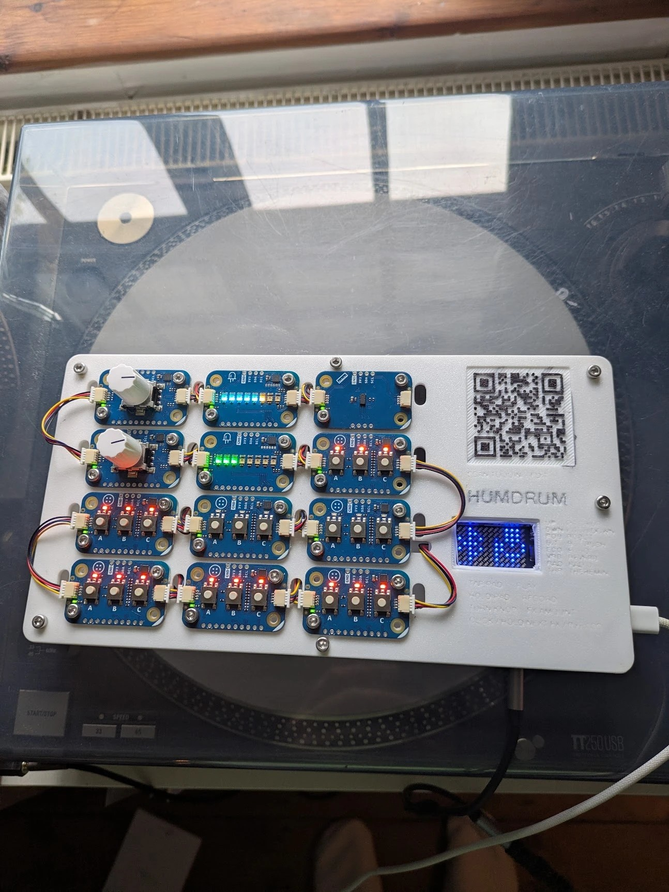
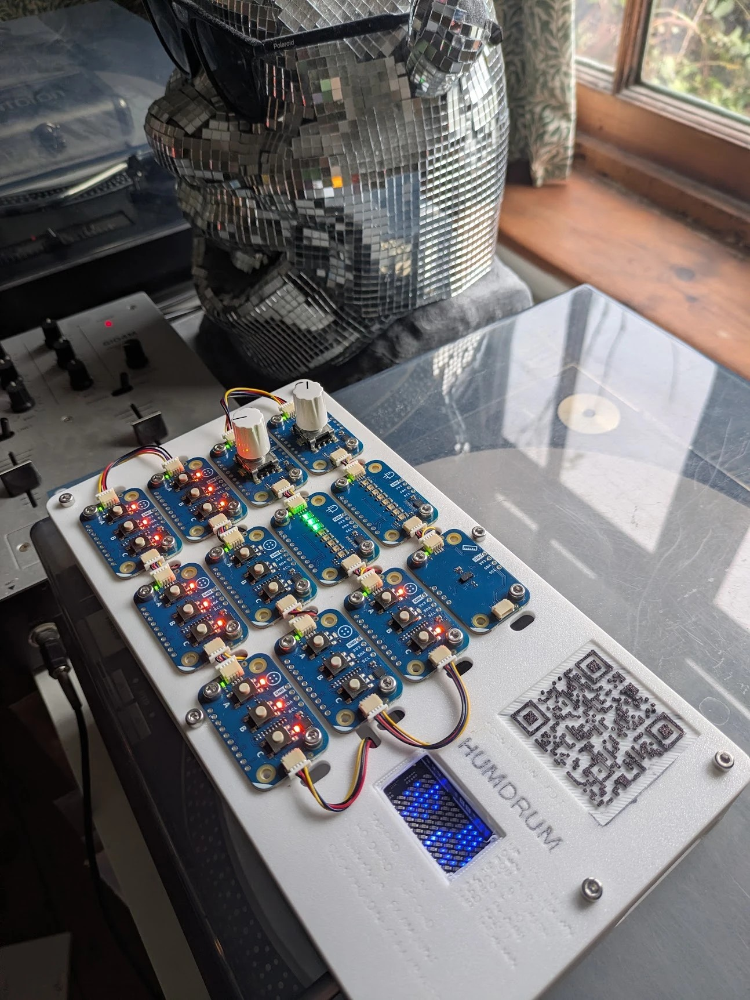
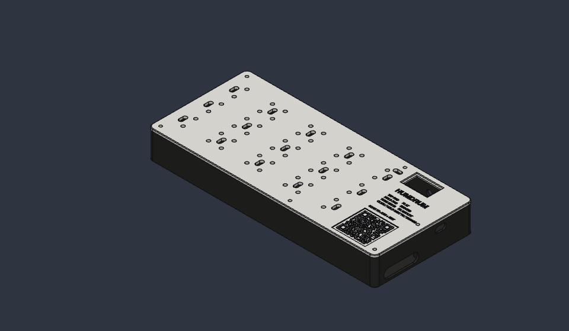
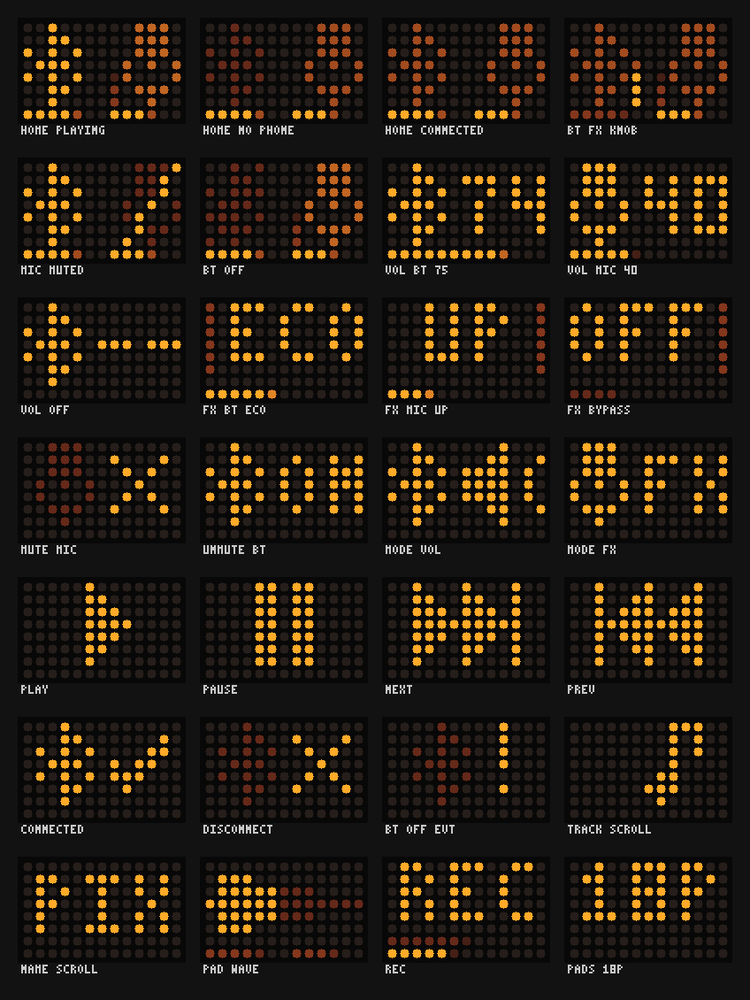
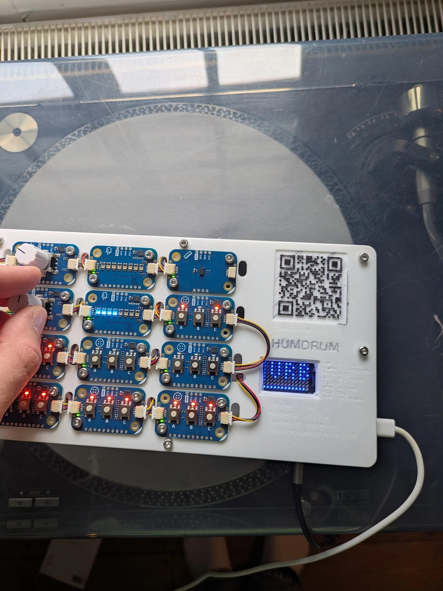
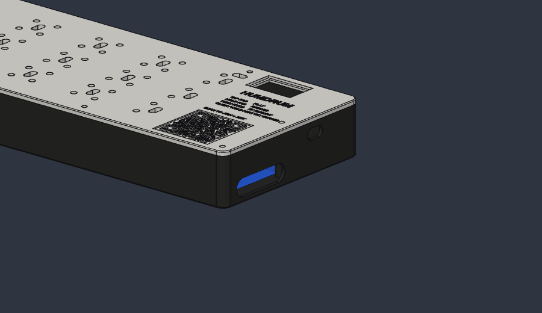
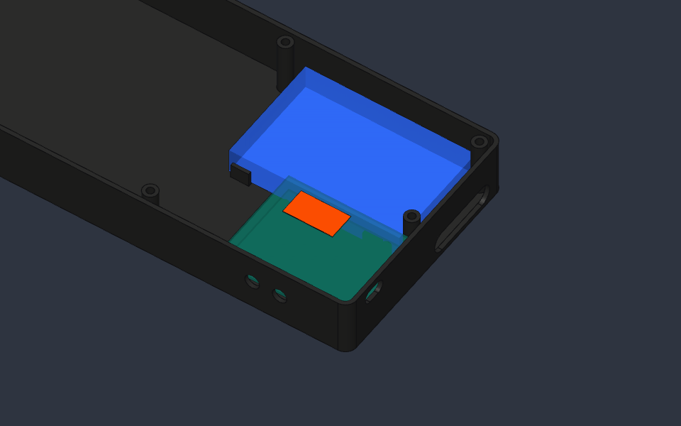
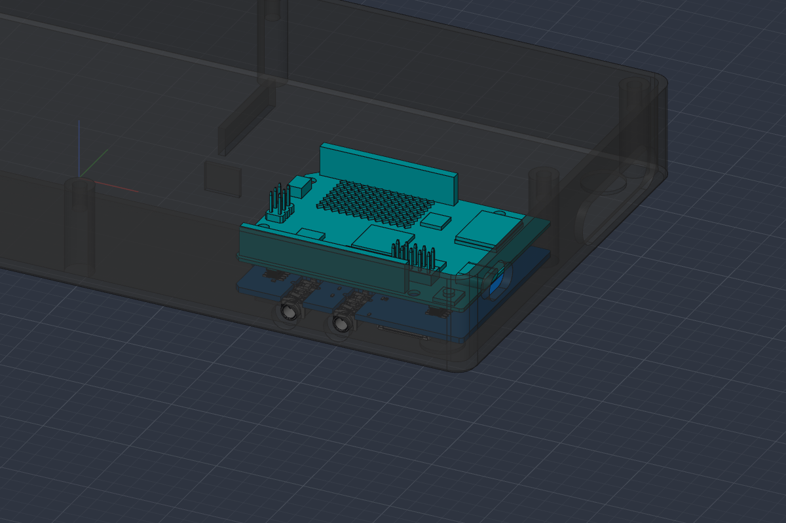
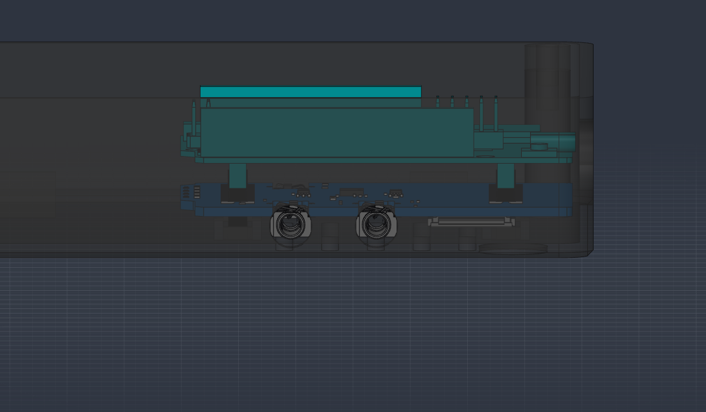
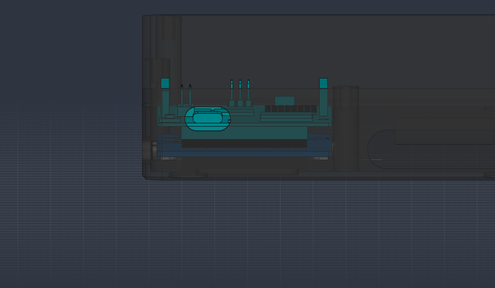

# Humdrum

**An extendable sampler and voice changer based on the UNO Q and Media Carrier combined with Modulino modules.**

A voice changer and sample-pad instrument for the Arduino UNO Q in a flat, instrument-style case.

- **Mic in → live FX → headphones or line out.** Seven effects: a DJ filter (flat at the knob's zero, the same "off" position as the other effects, then turn left for low-pass, right for high-pass), reverb, echo, radio, robot, bitcrush, and pitch (also off at zero: left shifts down, right shifts up, an octave each way), plus the Theremin with a Modulino Distance.
- **Your phone's music over Bluetooth**, in stereo, through its own effects bank (the same eight, shared with the sample pads).
- **Two Modulino Knobs**: one for the phone and pads, one for the mic. Turn for the volume or the effect amount, hold to swap between them, click for the next effect or mute. The phone knob has a third job, the **pad slot**.
- **Modulino Buttons become sample pads**, 3 per module, picked up automatically as you plug them in. The LED is on when a pad holds a sample. **Hold a pad to record** from the mic into it.
- **Four slots of sounds per pad**: hold the phone knob until the matrix shows `S1`, then turn it to switch every pad to slot 1–4 (or pick the slot in the web UI). Each slot is a full set of pad sounds, so 6 Buttons modules hold 72 samples.
- **A Wi-Fi hotspot with a captive portal.** Scan the QR code embossed on the lid, and your phone joins and opens the web UI. There you upload samples, trim, pitch and loop them, and change settings.
- **LED matrix display** behind a window in the lid shows the two channels the knobs control (phone + pads on the left, mic on the right), everything you change, **Bluetooth events** (connect, play/pause, skip, the new track's title scrolling by), `REC` while recording, and the **waveform of the sample you just triggered**, filling left to right as it plays. See [Reading the LED matrix](#reading-the-led-matrix).
- **Optional Modulino Buzzer** as a tone-only test speaker.
- **Optional Modulino Distance** adds a **Theremin** effect: hand height plays your voice's pitch. It appears in the effect list only while the sensor is plugged in.
- **Optional internal power bank bay**: a 93 × 61 × 14 mm 5000 mAh bank fits inside, its ports reachable through the right wall next to the UNO Q's USB-C.

<p>
  
  
</p>



---

## Hardware

### Required

| Part | Qty | Notes |
|---|---|---|
| Arduino UNO Q (2 GB) | 1 | Its built-in Wi-Fi runs the hotspot and its Bluetooth receives your phone's music: no extra radio needed |
| Arduino UNO Media Carrier (ASX00083) | 1 | Stacks under the UNO Q and provides the audio jacks |
| Modulino Knob | 2 | One for the phone and pads, one for the mic. Any grid slot |
| Modulino Buttons | 1 or more | 3 pads each, up to 16 modules (48 pads) or as many as your case has slots |
| Qwiic cables (50–100 mm) | 1 per module | Daisy-chained under the lid through the cable slots |
| Headphones, earphones or a 3.5 mm **TRS** cable to a mixer | 1 | Line out is **mono differential**: use a balanced input |
| Headset on a 3.5 mm **TRRS** (CTIA) plug, or a mic + headphones on a TRRS splitter | 1 | The mic is on the combo jack, with bias for an electret. A dynamic mic needs a preamp |
| USB-C power supply, 5 V / 3 A | 1 | Or the optional power bank below |

### Optional

| Part | Qty | Adds |
|---|---|---|
| Modulino Pixels | 0–2 | Level meters: one for phone + pads, one for the mic (set in the web UI) |
| Modulino Distance | 0 or 1 | The Theremin effect. Peel off the protective film! |
| Modulino Buzzer | 0 or 1 | A tone-only beeper for the pads or a pitch follower |
| Extra Modulino Buttons | 0 or 1 | Set to *Bluetooth controls* in the web UI: its three pads become previous, play/pause and next |
| A phone (or any Bluetooth audio source) | 0 or 1 | Music over Bluetooth, in stereo, with its own effects |
| 5000 mAh power bank, up to 93 × 61 × 14 mm, ports on a short end | 0 or 1 | Sits in the battery bay. Secure with hook-and-loop tape |
| Short USB-C cable (bank → UNO Q, 5 V / 3 A) | 0 or 1 | Runs **outside** the case; both openings are on the right wall |

Every Modulino takes one grid slot, so count the knobs and optional modules when you pick a case size (see *Enclosure*). The unit in the photos is the 3-column case with two Knobs, two Pixels, a Distance and seven Buttons modules: six of pads (18 pads) and one of Bluetooth controls.

### Case hardware

| Part | Qty | Notes |
|---|---|---|
| M3 heat-set inserts (M3 × 5.7, Ø4.0 hole) | 6 | Tray bosses |
| M3 × 6 button-head screws | 6 | Lid; meant to be visible |
| M3 × 6 self-tapping (thread-forming) screws | 4 per Modulino | Hold each Modulino flat on the lid |
| Hot glue | a little | Holds the Media Carrier's bottom sockets in their cradles |
| Clear or smoked acrylic, 33.6 × 20.6 × 1.5 mm | 1 | LED matrix window, glued into the rebate |
| Rubber feet, Ø12 × 1+ mm | 4 | Recesses in the tray |

### Audio jacks (Media Carrier)

The carrier has three 3.5 mm jacks: **Line Out** (mono, balanced), **Mic In / Headphones** (TRRS combo) and **Ear Out**. Two of them, on the UNO Q's digital-header edge, point out of the case's **front wall**. The third faces into the case and isn't used.

**Two channels, three jacks.** The codec has only two output channels, left and right, and the jacks share them:

| Jack | Plays |
|---|---|
| Headphones (combo jack) | left on the tip, right on the ring: stereo |
| Line out | the left channel, mono (balanced) |
| Ear out | the left channel, mono |

So at most two different signals come out at once. Stereo music with the mic on its own channel would need three; use the headphone jack for stereo, or split the mic and the music (*mic and music*, below), which makes the music mono.

> ⚠️ The datasheet doesn't say which physical jack is which. In the web UI, settings → *audio in / out* → **identify jacks** plays each jack on its own (1 beep = headphones/combo jack, 2 = line out, 3 = ear out) and shows which one is playing, so you can label the front wall to match. If the line out turns out to be the inward-facing jack, use a short 3.5 mm extension.

**The audio settings** (settings → *audio in / out*):

- **Mic input**: the Media Carrier's combo-jack mic, or a USB mic if one is plugged in. The *mic* meter under it shows the raw input level, and the line below says in plain words what's wrong if the input is silent or so noisy that the noise gate is muting it.
- **Output**: the Media Carrier, or a USB audio device. With the Media Carrier, tick which jacks play, in any combination. With only line out or ear out ticked, the mix is summed to mono so they don't lose the music's right channel.
- **Mic and music**: what the two channels carry.
  - *Same mix on every jack* (default): the music in stereo with the mic in the middle.
  - *Mic on line out*: the mic on the left channel (line out), the music in mono on the right (the headphone jack's ring). For a mixer's mic channel plus a line input.
  - *Music on line out*: the other way round.

  To use the right channel on its own, plug a 3.5 mm stereo-to-two-mono cable (to two RCA plugs or two jacks) into the headphone jack and use its right (red) leg; the left leg carries the same as line out. The mic and the music each get their own limiter, so a loud voice never turns the music down.
- **Test tone** plays a short beep on the ticked jacks at a fixed level (about −12 dBFS), whatever the master and sample levels are set to.

How it works: the app keeps the sound card on PipeWire's *Headphones* profile, which is the only one that routes the mic. Line out and ear out are switched on alongside it with the codec switches from Arduino's [Media Carrier user manual](https://docs.arduino.cc/tutorials/uno-media-carrier/user-manual/). The headphone path itself has to stay powered while audio is streaming (switching it off stalls the sound card), so unticking *headphones* mutes the combo jack's amplifier instead. The mic's capture gain is held low in the codec (`ADC2 Volume` 0, `TX_DEC0 Volume` 78, 6 dB under unity) so a loud voice has headroom, and the app adds its own gain after the rumble filter. A mic hot enough to clip the codec anyway pads `TX_DEC0` down by itself, in steps (*mic input pad* in settings).

**Mic plugs.** The mic input is on the combo jack, which follows the phone-headset (CTIA) layout: tip and ring are the **headphone outputs**, the sleeve is the mic. A 3-pole TRS mic plug puts its mic wire on a headphone output, so the mic capsule plays the output back at you, and it records nothing but hum. Use a TRS-to-TRRS (CTIA) mic adapter. Until then, untick *headphones* so the combo jack stays quiet.

---

## Software layout

```
humdrum/                   App Lab app (copy this folder into App Lab)
├── app.yaml                 uses the WebUI brick
├── sketch/sketch.ino        MCU: Qwiic bus, pads, knob, buzzer, LED matrix
├── python/
│   ├── main.py              Bridge ↔ engine ↔ web API glue, settings, LEDs, matrix
│   ├── engine.py            real-time audio thread: mic → FX → out, sample voices, recording
│   ├── fx.py                the 7 effects (block-vectorised numpy/scipy)
│   ├── slots.py             sample storage (48 kHz mono WAV in /app/data/slots)
│   ├── display.py           8×13 matrix frames (rotated 180°: the board sits USB-C-right)
│   ├── buzzer.py            pitch tracker + Modulino Buzzer modes
│   └── requirements.txt     scipy
├── assets/                  web UI (index.html, app.css, app.js, bundled socket.io)
├── host/portal/             captive-portal hotspot installer, run once on the board
├── tools/qr_emboss.py       regenerates the lid QR geometry from your hotspot credentials
└── enclosure/               CAD: STEP + STL per case width, master .sc design
```

### How pads are numbered

Each newly plugged Buttons module arrives at the factory address `0x3E`. The sketch moves it to the next free address in `0x40–0x5F` (stored in the module's flash) and blinks its LEDs three times to confirm. Pads are numbered by address, so **the order you first plug modules in is the pad order**.

- **Add modules one at a time** while the unit is on, about a second apart. Two brand-new modules plugged in together would both move to the same address.
- **To renumber**, go to web UI → settings → system → *reset button addresses*, unplug all Buttons modules, then plug them back in in the order you want.
- Samples are stored by pad number and slot, so they stay put when a module is unplugged and come back when it returns.

### Reading the LED matrix





The **home screen** is two strips that match the two knobs: **left = phone (Bluetooth) and sample pads, right = mic**.

| Where | What it means |
|---|---|
| Bluetooth symbol (left) | Dim: no phone · steady: connected, paused · pulsing with the music: playing · struck through: muted · blinking and struck through: Bluetooth is off (reboot to recover) |
| Mic (right) | Pulses with your voice while live · dim and struck through: muted |
| Thin column next to each icon | That channel's effect amount, bottom up, only while an effect is on (very dim: set but bypassed). With the Theremin it follows your hand. |
| Bottom row | Left half: phone + pads volume · right half: mic volume |
| Dot in the middle column | Which slot the pads play: top = slot 1, then every other row down to slot 4. Bright while the phone knob is in slot mode |
| Bright vs dim | Whatever each knob is set to change (its volume, its effect or the slot) is drawn brighter |

Whatever you do shows for about a second, full width:

- **Volume knob:** the channel's icon, its level 0-99 and a bar.
- **Effect knob or switching effect:** the effect's code (FLT, VRB, ECO, RAD, ROB, BIT, PIT, THR) and its amount; the filter shows LP/HP and pitch DWN/UP depending on which way it's turned; a line down the left edge means the phone/pads effect, down the right edge the mic's. `OFF` when bypassed.
- **Mute:** the icon with ✕ (muted) or `ON`.
- **Holding a knob:** the icon with a speaker (now a volume knob), `FX` (now an effect knob) or, on the phone knob, `S1`–`S4` (now a slot knob).
- **Changing slot:** `S1`–`S4` with a line down the left edge, and four marks along the bottom with the current one bright.
- **Bluetooth controls** (pads or knob click): ▶ ‖ ⏭ ⏮; a blinking Bluetooth ✕ if no phone is connected.
- **Phone connects:** Bluetooth ✓, then its name scrolls by. **Disconnects:** a blinking Bluetooth ✕.
- **New track** (skipped here or on the phone): ♪ and its title scrolling by. **Play/pause on the phone:** ▶ or ‖.

### Pad behaviour

| Action | Result |
|---|---|
| Tap | Plays the sample (one-shot / gate / loop, set per pad in the web UI). The LED matrix shows its waveform, bright where it has played and dim ahead, then returns to the home screen 0.25 s after it ends. Loops keep the waveform up until stopped. |
| Hold (600 ms, adjustable) | Starts recording from the mic into that pad. LED blinks fast and the matrix shows `REC`. Release to stop. |
| LED | Off = empty · on = loaded · flicker = playing · fast blink = recording (all for the slot the pads are on) |

### Slots

Every pad holds **four sounds, one per slot**, and all the pads play the same slot. To change it, **hold the phone knob** until the matrix shows `S1`–`S4` (it steps effect → volume → slot), then **turn** it to go up or down a slot, or **click** for the next slot (wrapping round from 4 to 1). Hold it again to get back to the effect. The web UI's pads panel has S1–S4 tabs too, which switch the hardware as well; the number on each tab is how many pads in that slot have a sound.

- A pad pressed before you switch keeps playing its sound, and its release (gate mode) and hold (record) still go to it. So a loop started in slot 1 carries on in slot 2; switch back to stop it.
- Hold a pad to record into the current slot. Recordings are named after the pad and the slot (`Pad 3 S2 · …`).
- In the pad editor, *move / swap* lists the pads of every slot, so a sound can go to another slot.
- Sounds from before slots existed are all in slot 1.

Recordings are auto-trimmed and normalised (both can be switched off), and can be recorded dry or with FX. *Rec over loaded pads* can be turned off to protect your samples.

### Theremin (optional Modulino Distance)

Plug in a Modulino Distance and an eighth effect, **THR**, joins the knob cycle and the web UI. Unplug it and THR disappears; if it was selected, Humdrum falls back to the first effect.

- **Your voice** is pitch-shifted by hand height, up to an octave either way at full amount. Closer is higher, as on a real theremin, and it glides rather than jumping.
- **An "ether" tone** (a sine with slow vibrato) follows the hand across three octaves, 110–880 Hz, at your voice's loudness. Hum to play it.
- **The knob** sets how much of both you get; 0 is fully dry.
- **The LED matrix** shows `THR` when you pick it, and on the home screen that channel's effect bar follows your hand height.
- **Range:** *theremin near mm* (default 40) and *theremin far mm* (default 350) in settings set the distances that count as closest and farthest. Nothing in range counts as far.

The sensor's ST driver (VL53L4CD, or VL53L4ED on some boards) is vendored in `sketch/src/` under its BSD licence, so App Lab can build the sketch on a board with no internet.

### Modulino Buzzer (optional)

The buzzer only plays a frequency for a set time on a piezo, so it can't reproduce audio. Choose a mode in settings:

- **pads**: each pad beeps at its own pitch (chromatic, pad 1 = middle C).
- **follow**: the output's dominant pitch is tracked and played, so your voice or a melodic sample comes out as a buzzy tone. Unpitched sounds stay silent.

---

### Bluetooth music

Pair your phone with **HUMDRUM** (no PIN) and its music plays through Humdrum in stereo:

- **The left knob is the phone's.** In volume mode it sets the Bluetooth level, in effect mode the amount of the phone + pads effect bank (all the effects, the filter included). Its first two clicks off zero are a dead zone, so a nudged knob doesn't colour the whole song.
- **The pads follow the Bluetooth volume** by default (settings → *bt knob sets pads too*), so a sample stays at the same level against the music. Untick it to set the pads on their own in the web UI.
- **The phone's own volume goes to full** when it connects: turning it down there, before the Bluetooth codec, makes quiet passages grainy. Use the knob instead.
- **Controls:** a Buttons module set to *Bluetooth controls* gives previous / play-pause / next, and a knob click can be set to play/pause. The LED matrix shows each one (▶ ‖ ⏭ ⏮) and scrolls the new track's title.
- **Connect / disconnect** shows on the matrix (Bluetooth ✓ and the phone's name, or a blinking ✕), so you don't need the web UI open.
- **If Bluetooth stops** (the symbol blinks, struck through), reboot. The board's Bluetooth chip occasionally hangs, and only a reset brings it back.

It needs the Bluetooth installer and Arduino's 7.0.14 kernel or newer; see *Deploying*.

The music is copied sample for sample from the Bluetooth decoder to the output (PipeWire already locks the phone's clock to the sound card's), behind a 150 ms cushion that rides out the radio's bad moments. That delay doesn't matter: nothing live has to line up with the music.

### Module roles

Each module's job is set on the web UI's **modules** page (settings → *modules*), so you can rearrange the lid without touching code:

- **Knobs:** *mic* or *Bluetooth + pads*, and whether it's on its volume, its effect or (Bluetooth knob) the pad slot (hold it to step through them).
- **Pixels:** *Bluetooth + sample pads level*, *mic level* or off. The meters are read before the master volume, so they light up at any listening level.
- **Buttons:** *sample pads* or *Bluetooth controls*.

## Deploying

1. **App.** Copy `humdrum/` into App Lab (or onto the board under `~/ArduinoApps/`) and run it. App Lab builds the sketch. The Python side needs only numpy, which the App Lab image already has.
2. **Kernel.** Bluetooth audio needs Arduino's `linux-image-7.0.14-arduino1+` or newer. On the 7.0.0 kernel the serial link to the Bluetooth chip stalls the moment music starts. It needs internet, so do it before turning the hotspot on:
   ```bash
   sudo apt update && sudo apt install linux-image-7.0.14-arduino1+
   ```
   ```bash
   sudo reboot
   ```
3. **Bluetooth and audio.** Run once on the board, then reboot. It installs the pairing helper (`humdrum-bt`), the PipeWire/WirePlumber rules that bring the phone's music into the app (and keep the codec on 16-bit, which fixes the hissy 24-bit mode), sets Bluetooth to classic only and to a music receiver only (no headset profile, so a laptop or phone never drops to call-quality audio, and a phone call never goes out through the PA), gives the audio server realtime priority and keeps the CPU at full speed (without those, a busy moment made the sound click):
   ```bash
   cd humdrum/host/bluetooth && sudo ./install.sh
   ```
   ```bash
   sudo reboot
   ```
   Add `NAME="My Humdrum"` before `./install.sh` to change the name your phone sees. A phone or laptop paired before this: forget HUMDRUM on it and pair again.
4. **Audio devices.** The defaults are the Media Carrier's mic and its headphone (combo) jack. Change them in the web UI under settings → *audio in / out* (see *The audio settings* above). *System* shows whether the devices are open, how many audio blocks have run, and the last audio error.
5. **Hotspot + captive portal.** On the board (over SSH or `adb shell`):
   ```bash
   cd humdrum/host/portal && sudo ./install.sh
   ```
   ```bash
   sudo humdrum-portal on
   ```
   This creates a NetworkManager access point using the SSID and password in `host/portal/wifi.local.env` if you've made one, otherwise the public demo credentials in `host/portal/wifi.env`. **They must match the QR embossed on your lid** (see *Your own Wi-Fi password* below). It also sets up wildcard DNS, the RFC 8910 portal option, and a port-80 redirector to the web UI on port 7000. The UNO Q has one Wi-Fi radio, so while the hotspot is on the board is off your home network. Run `sudo humdrum-portal off` to go back.

---

## Enclosure

The case is a flat, Teenage-Engineering-style slab: a dark tray, a light lid, and exposed button-head screws. The electronics strip is always on the right. It carries the LED matrix window, the engraved legend and the QR code. The window has a knob legend to its right (TURN level, CLICK next FX, HOLD switch between volume and FX), and below it the pad legend (TAP play, HOLD record) and an **FX key** to the matrix's effect codes in knob order: FLT filter, VRB reverb, ECO echo, RAD radio, ROB robot, BIT bitcrush, PIT pitch, THR theremin. All the lid text is Helvetica Neue Condensed Black at 3.2 mm cap height, engraved 0.5 mm deep. Its strokes are about 0.8 mm wide, so they come out cleanly with a 0.4 mm nozzle; the first version's 2–2.2 mm regular-weight text (0.3 mm strokes) closed up on a Prusa Core One+. The strip is identical at every case width, so every size has it. The Modulino grid grows to the left in **columns of 4 slots** (48 × 27.5 mm pitch, so neighbouring modules sit about 2 mm apart; Ø2.6 mm pilot holes on the Modulino's 32 × 16 mm pattern). Every slot has Qwiic pass-through slots on both sides, so the cables run hidden under the lid.

| Columns | Slots | Max pads (two knobs) | Case W × D × H | Fits a 256 mm bed? |
|---|---|---|---|---|
| 1 | 4 | 6 | **140 × 124 × 31 mm** | ✅ |
| 2 | 8 | 18 | **188 × 124 × 31 mm** | ✅ |
| 3 | 12 | 30 | **236 × 124 × 31 mm** | ✅ |
| 4 | 16 | 42 | **284 × 124 × 31 mm** | ❌ needs ≥ 290 mm (e.g. Prusa XL, Bambu H2D) |

Each optional module (Pixels, Distance, Buzzer, a Bluetooth-controls Buttons) takes a slot too, so subtract 3 pads for each one fitted.

Files: `enclosure/<n>col/` has the tray STL, lid STL and STEP. `enclosure/humdrum-enclosure.sc` is the master SolidCraft design: change the `cols` parameter to regenerate.

### Right wall: USB-C and battery ports

Both openings are on the **right wall**, so all power cables leave from one side:

- **UNO Q USB-C**: a 14 × 7.5 mm slot near the front of the wall, 8.5–22.5 mm back from the board's front edge, centred on the connector (1.5 mm above the UNO Q's top surface). Positioned from Arduino's 3D model of the UNO Q.
- **Power bank ports**: a 44 × 12 mm slot near the front of the same wall. It sits between the two right-hand screw bosses, which also act as end stops for the bank.

### Battery bay (optional)

A power bank up to **93 × 61 × 14 mm** lies on the floor along the rear of the case, behind the UNO Q, **ports facing the right wall** a few cm behind the USB-C. It sits under the QR area and the right-hand Modulino column. The rear wall, two ribs on the board side and one end rib (8 mm tall, 0.6 mm clearance) hold it in place; add a strip of hook-and-loop tape. A short USB-C cable loops **outside** the case from the bank's port to the UNO Q's USB-C, a few cm apart on the same wall. So the bank stays optional, and the unit runs from any USB-C supply without it.

- The bay is in the same place at every width (1–4 columns), and checked clash-free against the tray at 1 and 4 columns.
- The bank sits beside the PCB stack, about 0.7 mm clear of the Media Carrier's inward-facing jack. The two ribs on the board side are 1.2 mm thick, which leaves 0.5 mm between them and the board's edge.
- The bank's port end stops about 11 mm inside the wall, so normal plugs reach; very short stubby adapters may not.
- To make room for the bank, the rear-middle lid screw sits at x = 28 mm, and the rear-right screw takes the place of the front-right one (the board now fills that corner). The two middle screws sit 4.5 mm from the front and rear edges so their heads clear the outer Modulino rows.
- Check that your bank can supply the UNO Q (5 V, up to 3 A at peak). Some banks switch off at low current draw.

### Qwiic clearance

The UNO Q's Qwiic connector (QWIIC1) is on the board edge that faces the Modulino grid, about 15–18 mm above the floor. The space where the plug goes in (about 11 × 7 mm, up to the lid) is checked clear of the tray and the lid. A dedicated 10 × 5 mm **Qwiic pass-through** in the lid, just left of the LED matrix window, sits directly above the connector, so the first cable can go straight up to the nearest Modulino.




### How the boards are held

The Media Carrier has no mounting holes, so it isn't screwed down. Instead it sits on its two 30-pin bottom sockets, each in a U-shaped **cradle** on the tray floor: two 1.6 mm walls, 3.8 mm tall, along the socket's long sides, and a low end cap at each end. There's 0.25 mm of clearance all round. A dab of hot glue in each cradle stops it moving. The UNO Q plugs into the carrier's JMEDIA headers, with 7.7 mm between the UNO Q's underside and the carrier's top face.





The renders use Arduino's 3D models (UNO Q `ABX00162-step.zip`, Media Carrier `ASX00083-step.zip`, from docs.arduino.cc), placed in the case and checked for interference against the tray and lid. The models aren't in this repository; download them from Arduino to make your own assembly.

### Printing

- **Tray**: print open side up, no supports. PETG or ABS/ASA preferred; PLA is fine if the case stays out of the sun.
- **Lid**: print **top face up** so the QR modules and engraving come out crisp. Keep any engraved text you add at 0.6 mm stroke width or more (bold, 3 mm or taller); thinner strokes fill in. Holes and slots are vertical, so no supports needed.
- **Modulino mounting**: each Modulino sits flat on the lid and is held by four M3 × 6 self-tapping screws through its Ø3.2 holes into Ø2.6 mm pilot holes in the lid. The screws cut their own thread in the 3 mm lid; their tips poke about 1.4 mm out underneath, clear of everything in the tray. Don't overtighten: printed threads strip easily.

### Colouring the embossed QR

The QR's dark modules stand 0.8 mm up from a recessed 42 × 42 mm field and finish **flush with the lid top**. Swipe a Sharpie or paint marker across the tops: the recessed quiet zone and gaps stay light. For a cleaner result, put a **filament change at Z = 2.2 mm** (lid printed top up). The modules then print dark, along with the top 0.8 mm of the lid, while the recessed field stays light, so the code still scans.

The QR is a standard `WIFI:` code (v3-M, 29 × 29 modules at 1.25 mm) for the hotspot's SSID and password.

### Your own Wi-Fi password

The published lid files carry a **public demo** network: SSID `HUMDRUM`, password `humdrum-demo` (in `host/portal/wifi.env`). That's fine for trying things out, but anyone who reads this repo can join a hotspot using it. Before building a unit you'll keep:

1. Copy `host/portal/wifi.env` to `host/portal/wifi.local.env` and set your own `SSID` and `PASSWORD` (8+ characters). This file is gitignored.
2. Run `sudo ./install.sh` on the board. It prefers `wifi.local.env`.
3. Run `python3 tools/qr_emboss.py`. It reads `wifi.local.env` and writes `enclosure/local/qr_emboss.json` and `qr_emboss.stl` (also gitignored), so your password never ends up in a commit.
4. Make a lid with your QR on it. In `humdrum-enclosure.sc`, delete the `QrSketch` and `QrEmboss` features, recreate them from the rectangles in `enclosure/local/qr_emboss.json` (one rectangle each, then extrude 0.8 mm up from the recess floor and join to the lid), and export the lid.

`python3 tools/qr_emboss.py --demo` regenerates the published demo files in `enclosure/`.


### Fit notes: check these before a final print

Positions come from Arduino's 3D models of the UNO Q and Media Carrier. The board sits in the front-right corner, rotated 180° from the usual UNO orientation (USB-C to the right wall, digital header and jacks to the front):

- **USB-C** cut-out: right wall, 14 × 7.5 mm, spanning 8.5–22.5 mm back from the board's front edge, centred 1.5 mm above the UNO Q's top surface.
- **Jacks**: two Ø7.5 mm holes in the front wall, at 19.3 and 34.3 mm from the board's left edge. The jacks are mounted on the **underside** of the Media Carrier, so the holes are centred 3.04 mm below the carrier's top face (5.55 mm above the case bottom). The jack fronts stop 0.4 mm inside the wall.
- **Stack height**: the carrier's bottom sockets stand on the floor, and there's a 7.7 mm gap (measured) from the carrier's top face to the UNO Q's underside. The tallest part, the UNO Q's 2 × 5 pin header beside the USB-C, then ends 0.7 mm under the lid.
- **`lift`** (5 mm) sets the floor height. The stack fills the case almost exactly, so keep it at 5 mm. Raising it by more than 0.7 mm pushes the 2 × 5 header into the lid, and the jack holes, USB-C slot and power bank slot don't follow it.
- **LED matrix window**: 30 × 17 mm, over the matrix at its datasheet position.

Print the tray once in draft quality to check the jacks and USB-C before printing the final parts.

---

## What's been verified

- **Sketch** compiles for `arduino:zephyr:unoq`: 13 % flash, 17 % RAM.
- **Python** effects, slots, engine, recording, loop/gate/one-shot and the pitch tracker were tested offline (`numpy`/`scipy`). On the board a 512-sample block (10.7 ms of audio) takes about 3.3 ms on average with Bluetooth playing, and 7-9 ms at its slowest.
- **Web UI + REST API** were run end to end against a stub of the App Lab runtime: upload with in-browser decode, edit, swap, delete, settings, and phone-width layout.
- **CAD**: every feature was checked against computed volumes, all 4 widths regenerate with no errors, the exported STL sizes match the table, and the QR raster round-trips to the exact symbol.

- **Audio on the board** (Media Carrier, 2026-11-24/25): the mic's delay through the app is about 33 ms (it was 163 ms mic to speakers after a gig, measured acoustically); about 89 ms more is in the sound card, the Qualcomm DSP and the speakers. Bluetooth music comes out bit-exact, with no clicks over 50-70 s of a test tone, also while the effect knob is swept through every effect 20 times a second. A 256-frame period was tried and dropped: it saved 11 ms but skipped mic audio every 10-40 s. The *mic and music* split was checked on the output stream: each signal on its own channel, nothing on the other. How it was measured: `docs/handoff-audio-quality.md`.
- **The whole unit at a gig** (2026-11): seven Buttons modules, two Knobs, two Pixels and a Distance on one Qwiic chain, the hotspot and portal, Bluetooth from a phone and a laptop, and the printed case.

**Not yet tested:** the line out, and the *mic and music* split, into a mixer by ear.
