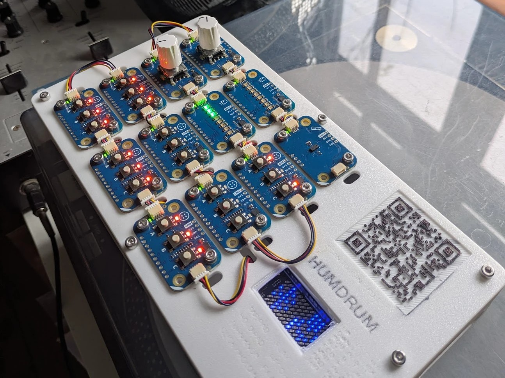
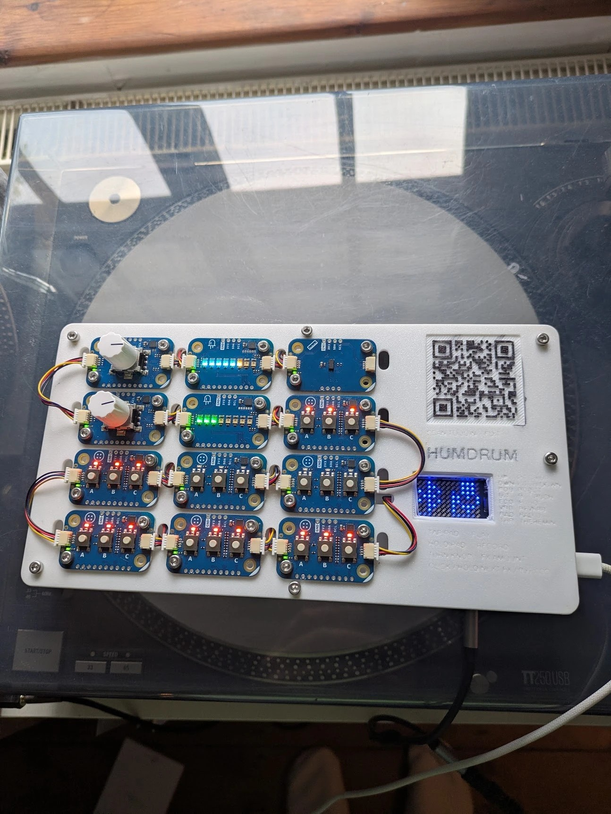
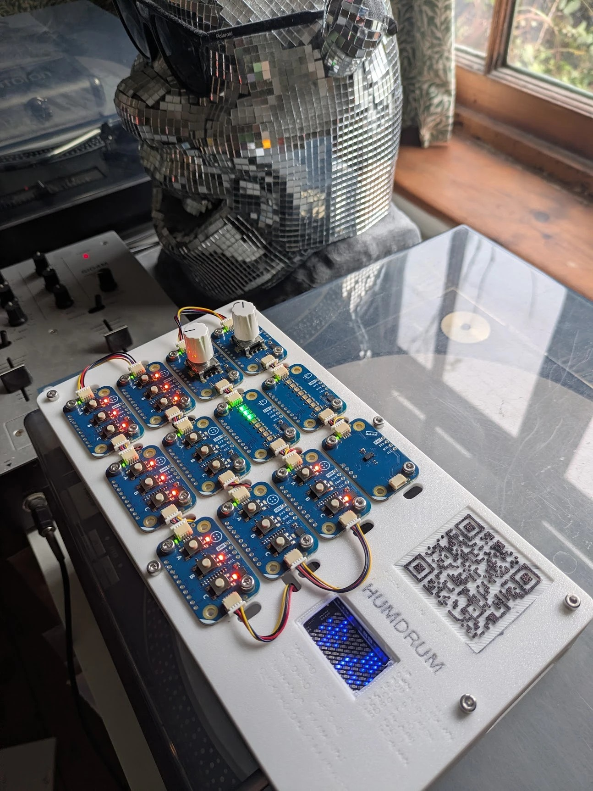
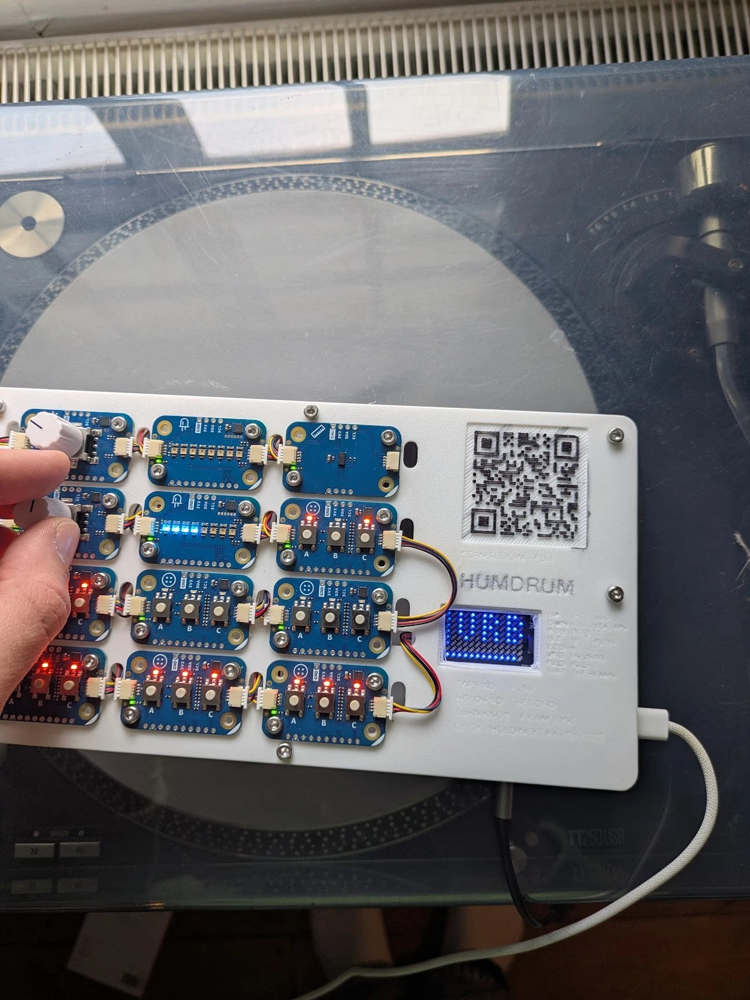
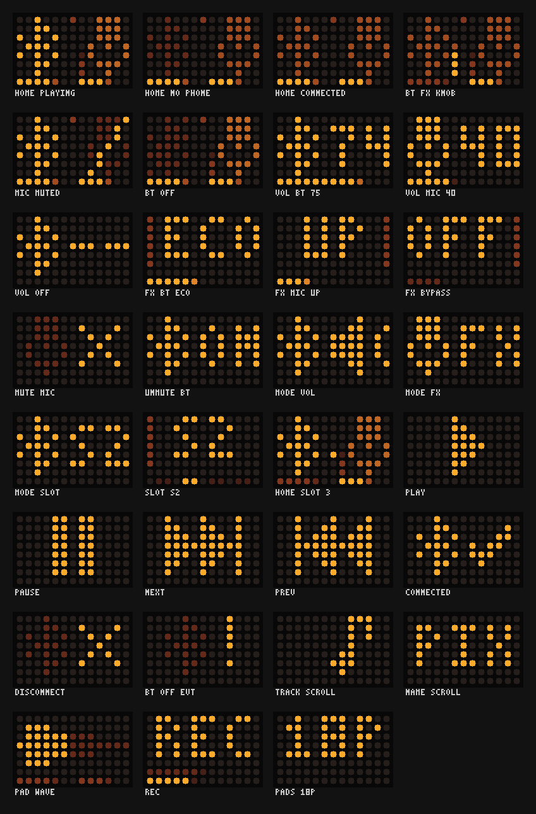

# Project Hub draft — Humdrum

Copy each section into the matching field of the Project Hub editor. Replace each
`[PHOTO: …]` or `[VIDEO: …]` placeholder with your own media. Renders referenced
here are in the repository's `enclosure/renders/` folder and photos in `docs/photos/`;
upload them to Project Hub where they appear.

> **Before publishing:** headphones, mic (headset or a real mic through a splitter),
> Bluetooth music and the captive portal have all been run on the board. The
> Media Carrier's balanced **line out** hasn't been tried with a mixer yet, so check
> that step against your build, and add a licence file to the repository (see
> *Credits and licence*).

---

## Cover image



## Title

**Humdrum: A Modular Sampler and Voice Changer with the Arduino UNO Q**

## Short description

An extendable sampler and voice changer based on the UNO Q and Media Carrier
combined with Modulino modules: live mic effects, your phone's music over
Bluetooth with its own effects, sample pads that record when you hold them, two
knobs, level meters, an LED matrix that shows everything, and a web UI you reach by
scanning a QR code on the case.

## Tags

`uno-q` · `app-lab` · `audio` · `dsp` · `sampler` · `voice-changer` · `modulino` ·
`media-carrier` · `bluetooth` · `captive-portal` · `3d-printing` · `music` · `dj`

## Difficulty / time

Intermediate · about 2 hours of assembly, plus printing time (the 2-column case is
about [CHECK: print time] for the tray and lid)

## Components and supplies

| Qty | Item |
|---|---|
| 1 | Arduino UNO Q (2 GB) |
| 1 | Arduino UNO Media Carrier (ASX00083), for the audio jacks |
| 2 | Modulino Knob (one for the phone and pads, one for the mic) |
| 1–16 | Modulino Buttons (3 pads each; as many as your case has slots, plus one more if you want Bluetooth previous / play-pause / next buttons) |
| 0–2 | Modulino Pixels (optional level meters: phone + pads, and mic) |
| 0–1 | Modulino Buzzer (optional, a tone-only test speaker) |
| 0–1 | Modulino Distance (optional, adds the Theremin effect) |
| 1 per module | Qwiic cables, 50–100 mm |
| 6 | M3 heat-set inserts (M3 × 5.7, Ø4.0 hole) |
| 6 | M3 × 6 button-head screws, for the lid |
| — | Hot glue, to hold the Media Carrier in its cradles |
| 1 | Clear or smoked acrylic, 33.6 × 20.6 × 1.5 mm, for the LED matrix window |
| 4 | Rubber feet, Ø12 mm |
| 1 | Headphones or earphones, or a 3.5 mm TRS cable to a balanced mixer input (the line out is mono differential) |
| 1 | Headset (TRRS, CTIA) in the combo jack, or a mic and headphones on a TRRS splitter |
| 0–1 | A phone, for music over Bluetooth (the UNO Q's built-in Bluetooth receives it; no extra radio) |
| 1 | USB-C power supply, 5 V / 3 A (or the power bank below) |
| 0–1 | 5000 mAh power bank, up to 93 × 61 × 14 mm, ports on a short end (optional) |
| 0–1 | Short USB-C cable, bank to UNO Q (optional) |
| 4 per Modulino | M3 × 6 self-tapping (thread-forming) screws |

## Tools

- 3D printer (1 to 3 columns fit a 256 mm bed; 4 columns needs about 290 mm)
- Soldering iron with a heat-set insert tip
- Screwdriver
- Sharpie or paint marker, for the embossed QR code

## Apps and platforms

- Arduino App Lab
- NetworkManager on the UNO Q (for the hotspot)
- BlueZ, PipeWire and WirePlumber on the UNO Q (for Bluetooth music)
- Arduino's `linux-image-7.0.14-arduino1+` kernel or newer (see *Software*)
- Any phone browser (for the web UI)

---

## Story



### The idea

I wanted something I could put on a DJ table next to a mixer: plug a mic into one
side, a line out into the mixer, and get a handful of silly voice effects and a grid
of sample pads with no laptop in sight. Most hardware samplers are fixed-size boxes.
Modulino modules made me want one that grows: plug in another Buttons module and you
get three more pads.



The **Arduino UNO Q** suits it well. The Linux side runs the audio in Python, with
effects, sample playback and recording. The microcontroller watches the Qwiic bus for
Modulinos, reads the pads and the knob, and drives the LED matrix. The **Media
Carrier** adds the audio jacks.

Then I wanted the music on the same box: pair your phone and its music plays
through Humdrum, in stereo, with its own effects bank, so you can sweep a filter or
throw an echo over a track while you talk over it and fire off an airhorn.

Settings and samples needed a screen, but I didn't want an app. So the board runs its
own Wi-Fi hotspot with a captive portal, and the QR code to join it is embossed into
the lid. Scan it and the web UI opens on your phone. Day to day you won't need it:
the LED matrix and the Pixels meters show everything.

[VIDEO: Humdrum in use — knob through the effects on a voice, tapping pads, holding a pad to record, the LED matrix reacting]

### How it works

```
mic ──────────► Media Carrier ─┐
phone ─ Bluetooth (SBC) ─► PipeWire ─┤
                                     ▼
              Python audio engine (Linux, 48 kHz, 512-sample blocks)
              mic:   rumble filter → noise gate → mic FX bank
              phone + pads: stereo → Bluetooth FX bank (one per channel)
              → mix → look-ahead limiter → headphones / line out
                                     │
               Router Bridge │ pads, knobs, hand height ▲   ▼ LEDs, meters, matrix frames
                                     │
              MCU sketch ─ Qwiic ─► Modulino Buttons, Knobs, Pixels, Buzzer, Distance
                         └─► LED matrix

phone ─► Wi-Fi hotspot ─► captive portal ─► web UI (settings, uploads, editing)
```

1. **Listen.** The engine reads the mic in 512-sample blocks at 48 kHz. A steep
   rumble filter and a noise gate that learns the room's noise floor keep hiss out
   of the effects. The phone's music arrives over Bluetooth through PipeWire, in
   stereo, into a short jitter buffer that follows the phone's clock with a
   windowed-sinc resampler.
2. **Transform.** Two effect banks: one for the mic, one for the phone and the pads.
3. **Play.** Everything is mixed, a look-ahead limiter catches peaks, and the result
   goes out in stereo to the headphones (or the line out).
4. **Control.** The microcontroller scans the Qwiic bus every second, so modules can
   be plugged in while it runs. It sends pad and knob events to Python over the
   Router Bridge, and Python sends back the pad LEDs, the Pixels meters and the LED
   matrix frames.

### The effects

| Matrix | Effect | What the knob does |
|---|---|---|
| FLT | Filter | DJ filter: flat at zero (the same "off" position as every other effect, so switching to it changes nothing); turn right for a high-pass up to 6 kHz, left for a low-pass down to 150 Hz. The matrix says HP or LP |
| VRB | Reverb | decay and level, from a small room to a long tail |
| ECO | Echo | level and feedback of a 280 ms echo that darkens with each repeat |
| RAD | Radio | a 450–2,600 Hz band-pass, driven harder into distortion |
| ROB | Robot | ring modulation, the carrier rising from 30 to 250 Hz |
| BIT | Bitcrush | from 12 bits down to 3, with sample-rate reduction |
| PIT | Pitch | off at zero like the filter; turn right to shift up, left to shift down, up to an octave each way. The matrix says UP or DWN |
| THR | Theremin | only with a Modulino Distance (see below) |

Both banks have the same effects. With two Modulino Knobs, one drives the phone and
pads, the other the mic:

- **Turn** a knob to set its volume, or its effect amount when it's in effect mode.
- **Hold** it to swap between volume and effect. The phone knob has a third mode,
  the pad slot (see *The pads*).
- **Click** it for the next effect (in effect mode), to mute (in volume mode) or for
  the next slot (in slot mode).

The amount stays put when you change effect. On the phone bank the first two clicks
are a dead zone, so a knob nudged off zero doesn't pitch-shift your whole song.



All the DSP is block-vectorised numpy. The pitch shifter is the classic two-tap
granular "harmonizer", with grains of about 43 ms, which keeps latency low for a
voice. The filter is a 513-tap FIR applied by FFT and redesigned as you turn the
knob. Changing effect crossfades from the old one to the new over 11 ms, with the
new one's buffers already filled, so switching never clicks. With Bluetooth music,
both banks and the limiter running, a block takes 5–7 ms of its 10.7 ms on the
UNO Q.

### The LED matrix and the meters



The idle screen is two strips that match the two knobs: the phone and pads on the
left, the mic on the right. The Bluetooth symbol is dim with no phone, steady when
connected and pulses with the music; the mic pulses with your voice; both get struck
through when muted. A thin column next to each shows its effect amount, the bottom
row both volumes, a dot in the middle column which pad slot is playing, and whatever
each knob is set to change is drawn brighter.

Everything you do shows for a second, full width: the volume (icon, 0–99 and a bar),
the effect and its amount, mute, knob mode, the pad slot, and the Bluetooth controls. When a phone
connects you get a tick and its name scrolls by; when you skip a track, its title
does. Two Modulino Pixels show the levels of the two channels.

### The pads

| Action | Result |
|---|---|
| Tap | Plays the sample: one-shot, gate or loop, set per pad in the web UI |
| Hold (600 ms) | Records from the mic into that pad until you let go |
| LED | off = empty · on = loaded · flicker = playing · fast blink = recording |

When you tap a pad, the LED matrix draws the sample's waveform and fills it in left
to right as it plays.

Each pad holds **four sounds, one per slot**. Hold the phone knob until the matrix
shows `S1`, then turn it to move all the pads to slot 2, 3 or 4; clicking steps to the
next slot. The matrix shows `S2` with four marks along the bottom, and the web UI has
matching S1–S4 tabs. Six Buttons modules give 18 pads, so 72 sounds without plugging
in anything else. A pad you're holding, or a loop you started, keeps its sound when
you change slot, so you can start a loop in one slot and play over it from another.

[PHOTO: close-up of the LED matrix showing a waveform while a pad plays]

Recordings are trimmed and normalised automatically. My first recordings with nothing
plugged into the mic jack overwrote pads with hiss, so a recording now has to rise
clearly above the measured noise floor or the pad keeps its old sample.

New Buttons modules all arrive at the same I²C address, `0x3E`. The sketch moves each
new one to the next free address (stored in the module's own flash) and blinks it
three times to confirm. Pads are numbered in the order you first plug modules in, and
samples stay with their pad number (and slot) when a module is unplugged.

### Theremin with a Modulino Distance

Plug in a Modulino Distance and an extra effect, **THR**, joins the knob cycle and
the web UI on both banks. Unplug it and it disappears again.

- Your voice is pitch-shifted by hand height, up to an octave either way, gliding
  rather than jumping. Closer is higher, as on a real theremin.
- An "ether" tone, a sine with slow vibrato, follows your hand across three octaves
  (110–880 Hz) at your voice's loudness. Hum to play it.
- On the matrix's home screen, that channel's effect bar follows your hand.

My first test read 0 mm whatever I did. The sensor still had its protective film on.
Peel it off!

[VIDEO: playing the theremin effect with a hand over the Distance module]

### Bluetooth music from your phone

Pair your phone with **HUMDRUM** (no PIN) and its music plays through Humdrum in
stereo, through its own effects bank. The left knob is the phone's: its volume, or
the amount of the phone + pads effect. The first two clicks off zero are a dead zone,
so a knob nudged by accident doesn't colour the whole song.

- **The pads follow the Bluetooth volume** by default, so a sample stays at the same
  level against the music. You can untick that in settings.
- **The phone's volume goes to full when it connects.** Turning it down in the
  phone, before the Bluetooth codec, makes quiet passages grainy, so the knob sets
  the level instead.
- **Controls:** give a Buttons module the Bluetooth role in the web UI and its three
  pads become previous, play/pause and next. A knob click can be set to play/pause.
- **You don't need the web UI open.** The LED matrix shows the phone connecting
  (a Bluetooth tick, then its name scrolling by), disconnecting (a blinking cross),
  each control, and the new track's title.

A small helper on the board (`host/bluetooth/`) is the pairing agent: it trusts the
phone, exposes the media controls to the app, and puts the adapter's settings back
if the controller ever resets.

[VIDEO: pairing a phone, then skipping tracks with the Bluetooth pads while the matrix scrolls the title]

### Three bugs worth knowing about

Getting the audio right took longer than everything else together. If you build on
the UNO Q, these will save you days:

- **The Media Carrier's 24-bit mode is mis-packed.** PipeWire opens the card as
  S24_LE, and the DSP treats each 32-bit word as a 16-bit sample in its top half.
  Playback reached the DAC 48 dB too quiet with about 8 bits left (hissy, squashed
  and quiet whatever you did), and the mic came back 48 dB too hot, wrapping around
  instead of clipping. A WirePlumber rule that opens both directions as S16LE fixes
  it; the installer adds it.
- **Bluetooth died the moment music started.** On the stock 7.0.0 kernel, one
  hiccup in the serial port to the Bluetooth chip (`serial engine reports 0 RX bytes
  in!`) left the port deaf for good, so every command to the chip timed out.
  Arduino fixed it in their 7.0.14 kernel.
- **Clicks on every effect change.** Each change rebuilt the web UI's state, which
  recomputed every pad's waveform preview while holding Python's GIL, and the
  audio thread missed its deadline: one block of silence. Caching the previews,
  coalescing updates and a 1 ms GIL switch interval fixed it.

### Web UI and the QR code

[PHOTO: phone showing the web UI next to the unit]

Scan the QR code on the lid and your phone joins the board's hotspot. The captive
portal opens the web UI automatically, with no address to type. There you can:

- pick both banks' effects, set amounts and levels, and see the meters
- see what's playing on the phone and control it
- upload samples (your phone converts any audio file it can play before uploading);
  a 12-sample dancehall kit (airhorns, sirens, rewind, explosions) is loaded onto
  the first pads out of the box
- trim, re-pitch, reverse and reorder pads, and set each one to one-shot, gate or loop
- change settings, each shown with its default (click it to go back): master,
  headphone amp, mic gain and input pad, noise gate, hold time, recording options,
  buzzer mode and the theremin's range
- set up modules (which knob and Pixels does what) and read diagnostics

The hotspot uses NetworkManager in shared mode, wildcard DNS that answers every name
with the board's address, and the RFC 8910 captive-portal option, so phones
recognise it as a portal.

---

## Building it

### The enclosure


The case is a flat, Teenage Engineering–style slab: a dark tray, a light lid, visible
button-head screws, and Modulinos screwed flat onto the lid. The electronics strip
on the right holds the LED matrix window, the QR code, an engraved legend for the
controls, and a key to the effect codes on the matrix. All the text is a heavy
condensed font at 3.2 mm, with strokes about 0.8 mm wide: my first lid used 2 mm
regular-weight text, and its 0.3 mm strokes filled in on the printer. The Modulino grid grows to the left in columns of four slots.

| Columns | Slots | Max pads (two knobs) | Size |
|---|---|---|---|
| 1 | 4 | 6 | 140 × 124 × 31 mm |
| 2 | 8 | 18 | 188 × 124 × 31 mm |
| 3 | 12 | 30 | 236 × 124 × 31 mm |
| 4 | 16 | 42 | 284 × 124 × 31 mm |

A Pixels, Buzzer or Distance module, or a Buttons module used for Bluetooth controls,
each take a slot too, so subtract three pads for each one. The unit in the photos is the 3-column case with
two knobs, two Pixels, a Distance and seven Buttons modules: six of pads (18 pads)
and one of Bluetooth controls.


All the print files are in the repository's `enclosure/` folder: tray and lid STLs
and a STEP for each width, and the parametric SolidCraft design.

- **Tray:** open side up, no supports. PETG or ABS/ASA is best; PLA is fine out of
  the sun.
- **Lid:** top face up, so the QR code and engraving come out crisp.

[PHOTO: the printed tray and lid]

### Colouring the QR code

The QR code's dark squares are raised 0.8 mm from a recessed field, finishing flush
with the lid. Swipe a Sharpie or paint marker across the top and only the squares
take the colour. For a cleaner result, put a filament change at Z = 2.2 mm: the
squares then print dark and the recessed field stays light.

[PHOTO: colouring the embossed QR code with a marker]

The published lid carries a public demo network (SSID `HUMDRUM`, password
`humdrum-demo`). For a unit you'll keep, set your own credentials and regenerate the
QR code with `tools/qr_emboss.py`, as described in the README. Your password never
needs to go into the repository.

### Assembly

[PHOTO: inside the tray with the UNO Q and Media Carrier in their cradles, and the power bank in its bay]


1. **Inserts.** Press the six M3 heat-set inserts into the tray's corner bosses.
2. **Board.** Plug the UNO Q onto the Media Carrier's JMEDIA headers. The carrier
   has no mounting holes, so instead lower its two bottom sockets into the U-shaped
   cradles in the front-right corner. The jacks then line up with the holes in the
   front wall and the USB-C with the slot in the right wall. A dab of hot glue in
   each cradle stops it moving.
3. **Power bank (optional).** Lay it along the rear wall with its ports facing the
   right wall, held by the printed ribs and a strip of hook-and-loop tape. A short
   USB-C cable loops outside the case from the bank to the UNO Q. Without it, the
   unit runs from any USB-C supply.
4. **Window.** Glue the acrylic into the rebate above the LED matrix.
5. **Modulinos.** Screw each Modulino flat onto the lid with four M3 × 6 self-tapping
   screws. They cut their own thread in the lid's Ø2.6 mm pilot holes, so don't
   overtighten them.
6. **Cables.** Daisy-chain the Modulinos with Qwiic cables through the slots in the
   lid, and run the first one down through the pass-through next to the matrix window
   to the UNO Q's Qwiic connector.
7. **Close.** Screw the lid on with the six button-head screws and stick on the feet.


[PHOTO: the finished unit from the front, jacks visible, with a mic and a cable to a mixer plugged in]

### Software

The whole project is one Arduino App. Clone it onto the board:

```bash
cd ~/ArduinoApps
git clone https://github.com/jimbruges/humdrum.git humdrum
```

It shows up in App Lab under **My Apps**. Run it, and App Lab builds the sketch. The
Python side needs only numpy, which App Lab already has. The main parts:

- `sketch/sketch.ino` — the microcontroller: Qwiic bus scanning and auto-addressing,
  pads, knobs, Pixels, buzzer, distance sensor and LED matrix.
- `python/engine.py` — the real-time audio thread: mic, Bluetooth input, effect
  banks, sample voices, recording and the limiter.
- `python/fx.py` — the effects (seven, plus the Theremin).
- `python/display.py` — the LED matrix screens.
- `python/main.py` — connects the Bridge, the engine and the web API, and stores the
  settings.
- `python/audio_ports.py`, `python/bt.py`, `python/slots.py` — codec setup, the
  Bluetooth helper's client, and the sample library and pads.
- `assets/` — the web UI. `samples/` — the dancehall kit.
- `host/portal/` — the hotspot and captive-portal installer.
- `host/bluetooth/` — the Bluetooth helper and audio installer.

**Kernel.** Update to Arduino's 7.0.14 kernel first, or Bluetooth audio stops the
moment music starts (see *Three bugs*). It needs internet, so do it before turning
the hotspot on:

```bash
sudo apt update && sudo apt install linux-image-7.0.14-arduino1+
```

```bash
sudo reboot
```

**Bluetooth and audio.** Run the installer once. It sets up the pairing helper, the
PipeWire/WirePlumber rules (including the 16-bit fix) and classic-only Bluetooth:

```bash
cd ~/ArduinoApps/humdrum/host/bluetooth && sudo ./install.sh
```

Then set up the hotspot once, on the board:

```bash
cd ~/ArduinoApps/humdrum/host/portal && sudo ./install.sh
```

```bash
sudo humdrum-portal on
```

The UNO Q has one Wi-Fi radio, so while the hotspot is on the board is off your home
network. `sudo humdrum-portal off` switches back.

**Audio devices:** the defaults (`jack:1` in and out, the Media Carrier) work. Pick
the outputs in the web UI's settings: headphones (the combo jack), line out or ear
out, or several at once.

---

### Tips

- **Use a balanced input on the mixer.** The Media Carrier's line out is mono
  differential, so a TRS cable into a balanced input gives the cleanest signal.
- **The mic jack wants a TRRS (CTIA) plug**, like a phone headset. For a real mic,
  use a TRRS splitter. A hot mic clips the codec at first; the app notices and pads
  the codec's gain down by itself (*mic input pad* in settings).
- **Sensitive earphones?** Turn *master* down (it's in dB, so most of its travel is
  the quiet end) and use the knobs from there.
- **If Bluetooth stops working** (the matrix shows the Bluetooth symbol blinking and
  struck through), reboot: the chip occasionally hangs and only a reboot resets it.
- **Add Buttons modules one at a time**, about a second apart, while the unit is on.
  Two new modules plugged in together would both move to the same address.
- **To renumber the pads**, use *reset button addresses* in the web UI, unplug all the
  Buttons modules, then plug them back in in the order you want.
- **The Modulino Buzzer** can't play audio, only a pitch. Set it to *pads* for a beep
  per pad, or *follow* to buzz along with the pitch of whatever is playing.

### What's next

- MIDI out, so the pads can trigger a drum machine
- Saving and loading whole banks of samples from the web UI
- Chaining two effects at once
- aptX or AAC from the phone (this PipeWire build only decodes SBC)

### Credits and licence

- **ST VL53L4CD / VL53L4ED drivers**, vendored in `sketch/src/` under ST's BSD-3-Clause
  licence.
- **Socket.IO** client, bundled in `assets/` under the MIT licence.
- This project's code and print files: [CHECK: add a LICENSE file to the repository and name it here]

---

## Code

Link the repository: <https://github.com/jimbruges/humdrum>.

## Schematics

No wiring beyond Qwiic cables: the UNO Q stacks on the Media Carrier, and every
Modulino daisy-chains on the UNO Q's Qwiic connector.
[PHOTO: optional diagram of the stack and the Qwiic chain]
