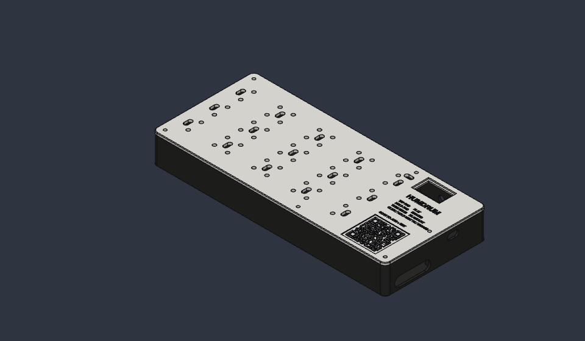
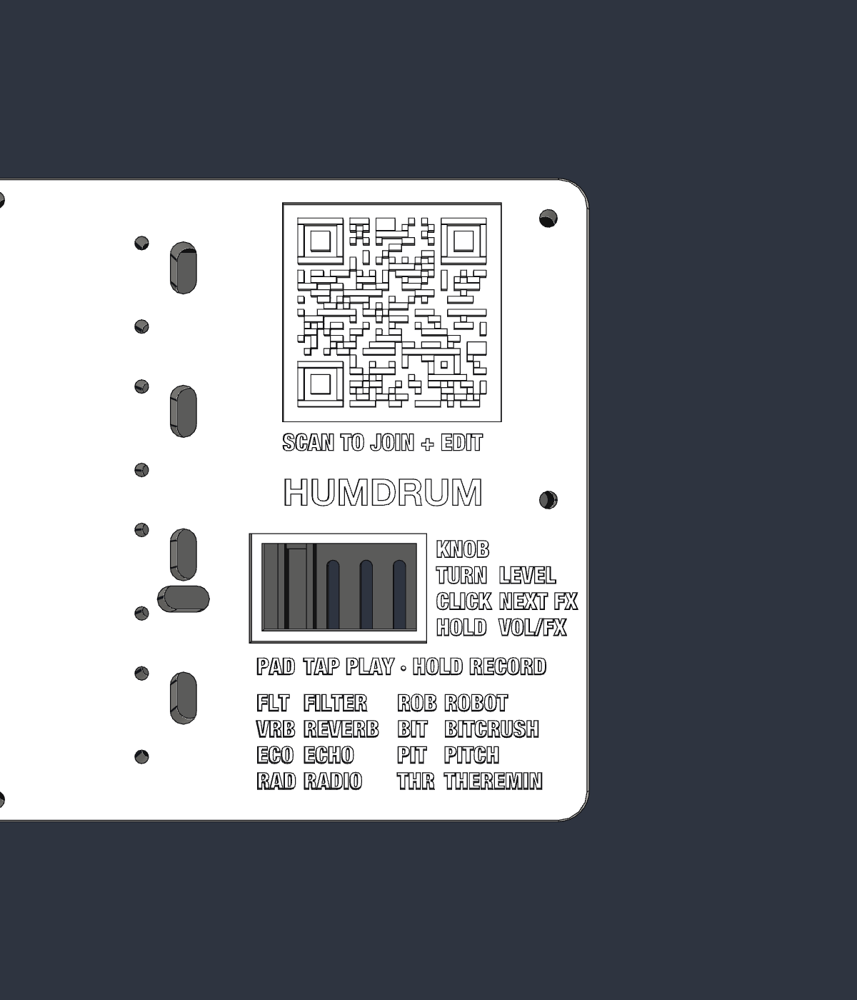
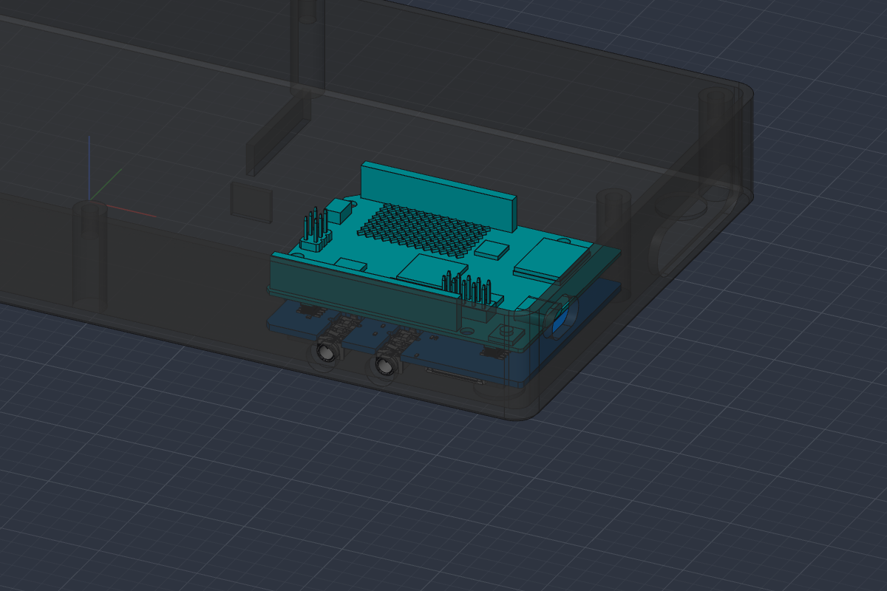
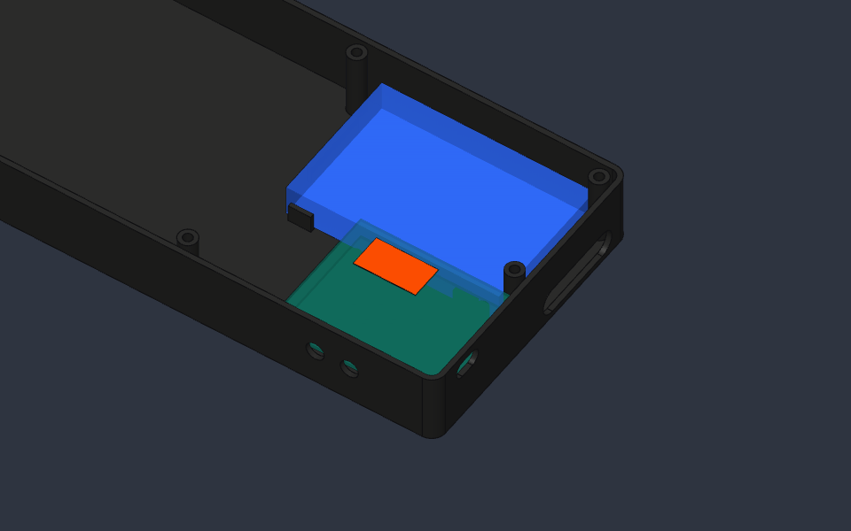
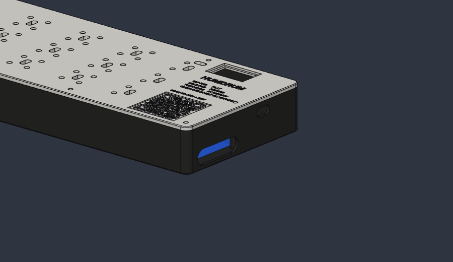

# Project Hub draft — Humdrum

Copy each section into the matching field of the Project Hub editor. Replace each
`[PHOTO: …]` or `[VIDEO: …]` placeholder with your own media. Renders referenced
here are in the repository's `enclosure/renders/` folder; upload them to Project Hub
where they appear.

> **Before publishing:** line out and mic through the Media Carrier, and the
> captive portal, haven't been run on the board yet (see *What's been verified* in
> the README). Check the audio-device and portal steps below against your build,
> and add a licence file to the repository (see *Credits and licence*).

---

## Cover image

[PHOTO: cover, 4:3 — the finished unit on a desk next to a mixer, mic plugged in, a few pads lit and the LED matrix showing an effect]

## Title

**Humdrum: A Modular Sampler and Voice Changer with the Arduino UNO Q**

## Short description

An extendable sampler and voice changer based on the UNO Q and Media Carrier
combined with Modulino modules: live mic effects to a line out, sample pads that
record when you hold them, a knob for the effects, and a web UI you reach by
scanning a QR code on the case.

## Tags

`uno-q` · `app-lab` · `audio` · `dsp` · `sampler` · `voice-changer` · `modulino` ·
`media-carrier` · `captive-portal` · `3d-printing` · `music` · `dj`

## Difficulty / time

Intermediate · about 2 hours of assembly, plus printing time (the 2-column case is
about [CHECK: print time] for the tray and lid)

## Components and supplies

| Qty | Item |
|---|---|
| 1 | Arduino UNO Q (2 GB) |
| 1 | Arduino UNO Media Carrier (ASX00083), for the audio jacks |
| 1 | Modulino Knob |
| 1–15 | Modulino Buttons (3 pads each; as many as your case has slots) |
| 0–1 | Modulino Buzzer (optional, a tone-only test speaker) |
| 0–1 | Modulino Distance (optional, adds the Theremin effect) |
| 1 per module | Qwiic cables, 50–100 mm |
| 6 | M3 heat-set inserts (M3 × 5.7, Ø4.0 hole) |
| 6 | M3 × 6 button-head screws, for the lid |
| — | Hot glue, to hold the Media Carrier in its cradles |
| 1 | Clear or smoked acrylic, 33.6 × 20.6 × 1.5 mm, for the LED matrix window |
| 4 | Rubber feet, Ø12 mm |
| 1 | 3.5 mm TRS cable to a balanced mixer input (the line out is mono differential) |
| 1 | Electret or headset mic on a 3.5 mm TRRS (CTIA) plug |
| 0–1 | 5000 mAh power bank, up to 93 × 61 × 14 mm, ports on a short end (optional) |
| 0–1 | Short USB-C cable, bank to UNO Q (optional) |
| 4 per Modulino | M3 × 6 self-tapping (thread-forming) screws |

## Tools

- 3D printer (1 to 3 columns fit a 256 mm bed; 4 columns needs about 290 mm)
- Soldering iron with a heat-set insert tip
- Screwdriver
- Sharpie or paint marker, for the embossed QR code

## Apps and platforms

- Arduino App Lab
- NetworkManager on the UNO Q (for the hotspot)
- Any phone browser (for the web UI)

---

## Story

[PHOTO: the finished unit from above, with a full grid of Modulinos]

### The idea

I wanted something I could put on a DJ table next to a mixer: plug a mic into one
side, a line out into the mixer, and get a handful of silly voice effects and a grid
of sample pads with no laptop in sight. Most hardware samplers are fixed-size boxes.
Modulino modules made me want one that grows: plug in another Buttons module and you
get three more pads.

The **Arduino UNO Q** suits it well. The Linux side runs the audio in Python, with
effects, sample playback and recording. The microcontroller watches the Qwiic bus for
Modulinos, reads the pads and the knob, and drives the LED matrix. The **Media
Carrier** adds the audio jacks.

Settings and samples needed a screen, but I didn't want an app. So the board runs its
own Wi-Fi hotspot with a captive portal, and the QR code to join it is embossed into
the lid. Scan it and the web UI opens on your phone.

[VIDEO: Humdrum in use — knob through the effects on a voice, tapping pads, holding a pad to record, the LED matrix reacting]

### How it works

```
mic ─► Media Carrier ─► Python audio engine (Linux) ─► line out ─► mixer
                          │  noise gate → FX → mix with sample voices
                          │
            Router Bridge │ pads, knob, hand height ▲   ▼ LED states, matrix frames
                          │
                 MCU sketch ─ Qwiic ─► Modulino Buttons, Knob, Buzzer, Distance
                          └─► LED matrix

phone ─► Wi-Fi hotspot ─► captive portal ─► web UI (settings, uploads, editing)
```

1. **Listen.** The audio engine reads the mic in 512-sample blocks at 48 kHz. A
   high-pass filter removes rumble, and a noise gate that adapts to the room's own
   noise floor keeps hiss out of the effects.
2. **Transform.** The selected effect runs on each block, scaled by the knob.
3. **Play.** Triggered samples are mixed in and the result goes to the line out.
4. **Control.** The microcontroller scans the Qwiic bus every second, so modules can
   be plugged in while it runs. It sends pad and knob events to Python over the
   Router Bridge, and Python sends back the pad LED states and the LED matrix frames.

### The effects

| Matrix | Effect | What the knob does |
|---|---|---|
| UP | Pitch up | up to an octave higher |
| DWN | Pitch down | up to an octave lower |
| ROB | Robot | ring modulation, the carrier rising from 30 to 250 Hz |
| BIT | Bitcrush | from 12 bits down to 3, with sample-rate reduction |
| ECO | Echo | level and feedback of a 280 ms echo that darkens with each repeat |
| VRB | Reverb | decay and level, from a small room to a long tail |
| RAD | Radio | a 450–2,600 Hz band-pass, driven harder into distortion |
| THR | Theremin | only with a Modulino Distance (see below) |

- **Turn** the knob to set the amount. The matrix shows it as a bar.
- **Click** it for the next effect.
- **Hold** it to bypass.

All the DSP is block-vectorised numpy. The pitch shifter is the classic two-tap
granular "harmonizer", with grains of about 43 ms, which keeps latency low for a
voice. A whole block takes about 0.1 ms on a desktop CPU against a 10.7 ms budget,
so there's plenty of headroom on the UNO Q.

### The pads

| Action | Result |
|---|---|
| Tap | Plays the sample: one-shot, gate or loop, set per pad in the web UI |
| Hold (600 ms) | Records from the mic into that pad until you let go |
| LED | off = empty · on = loaded · flicker = playing · fast blink = recording |

When you tap a pad, the LED matrix draws the sample's waveform and fills it in left
to right as it plays.

[PHOTO: close-up of the LED matrix showing a waveform while a pad plays]

Recordings are trimmed and normalised automatically. My first recordings with nothing
plugged into the mic jack overwrote pads with hiss, so a recording now has to rise
clearly above the measured noise floor or the pad keeps its old sample.

New Buttons modules all arrive at the same I²C address, `0x3E`. The sketch moves each
new one to the next free address (stored in the module's own flash) and blinks it
three times to confirm. Pads are numbered in the order you first plug modules in, and
samples stay with their pad number when a module is unplugged.

### Theremin with a Modulino Distance

Plug in a Modulino Distance and an eighth effect, **THR**, joins the knob cycle and
the web UI. Unplug it and it disappears again.

- Your voice is pitch-shifted by hand height, up to an octave either way, gliding
  rather than jumping. Closer is higher, as on a real theremin.
- An "ether" tone, a sine with slow vibrato, follows your hand across three octaves
  (110–880 Hz) at your voice's loudness. Hum to play it.
- The matrix row above the knob bar shows your hand height.

My first test read 0 mm whatever I did. The sensor still had its protective film on.
Peel it off!

[VIDEO: playing the theremin effect with a hand over the Distance module]

### Web UI and the QR code

[PHOTO: phone showing the web UI next to the unit]

Scan the QR code on the lid and your phone joins the board's hotspot. The captive
portal opens the web UI automatically, with no address to type. There you can:

- pick effects, set the amount and see input and output meters
- upload samples (your phone converts any audio file it can play before uploading)
- trim, re-pitch, reverse and reorder pads, and set each one to one-shot, gate or loop
- change settings: mic gain, noise gate, hold time, recording options, buzzer mode
  and the theremin's range

The hotspot uses NetworkManager in shared mode, wildcard DNS that answers every name
with the board's address, and the RFC 8910 captive-portal option, so phones
recognise it as a portal.

---

## Building it

### The enclosure



The case is a flat, Teenage Engineering–style slab: a dark tray, a light lid, visible
button-head screws, and Modulinos screwed flat onto the lid. The electronics strip
on the right holds the LED matrix window, the QR code, an engraved legend for the
controls, and a key to the effect codes on the matrix. The Modulino grid grows to the
left in columns of four slots.

| Columns | Slots | Max pads (knob in one slot) | Size |
|---|---|---|---|
| 1 | 4 | 9 | 140 × 124 × 31 mm |
| 2 | 8 | 21 | 188 × 124 × 31 mm |
| 3 | 12 | 33 | 236 × 124 × 31 mm |
| 4 | 16 | 45 | 284 × 124 × 31 mm |

A Buzzer or Distance module takes a slot too, so subtract three pads for each one.



All the print files are in the repository's `enclosure/` folder: tray and lid STLs
and a STEP for each width, and the parametric SolidCraft design.

- **Tray:** open side up, no supports. PETG or ABS/ASA is best; PLA is fine out of
  the sun.
- **Lid:** top face up, so the QR code and engraving come out crisp.

[PHOTO: the printed tray and lid]

### Colouring the QR code

The QR code's dark squares are raised 0.8 mm from a recessed field, finishing flush
with the lid. Swipe a Sharpie or paint marker across the top and only the squares
take the colour. For a cleaner result, put a filament change at Z = 2.2 mm: the
squares then print dark and the recessed field stays light.

[PHOTO: colouring the embossed QR code with a marker]

The published lid carries a public demo network (SSID `HUMDRUM`, password
`humdrum-demo`). For a unit you'll keep, set your own credentials and regenerate the
QR code with `tools/qr_emboss.py`, as described in the README. Your password never
needs to go into the repository.

### Assembly

[PHOTO: inside the tray with the UNO Q and Media Carrier in their cradles, and the power bank in its bay]





1. **Inserts.** Press the six M3 heat-set inserts into the tray's corner bosses.
2. **Board.** Plug the UNO Q onto the Media Carrier's JMEDIA headers. The carrier
   has no mounting holes, so instead lower its two bottom sockets into the U-shaped
   cradles in the front-right corner. The jacks then line up with the holes in the
   front wall and the USB-C with the slot in the right wall. A dab of hot glue in
   each cradle stops it moving.
3. **Power bank (optional).** Lay it along the rear wall with its ports facing the
   right wall, held by the printed ribs and a strip of hook-and-loop tape. A short
   USB-C cable loops outside the case from the bank to the UNO Q. Without it, the
   unit runs from any USB-C supply.
4. **Window.** Glue the acrylic into the rebate above the LED matrix.
5. **Modulinos.** Screw each Modulino flat onto the lid with four M3 × 6 self-tapping
   screws. They cut their own thread in the lid's Ø2.6 mm pilot holes, so don't
   overtighten them.
6. **Cables.** Daisy-chain the Modulinos with Qwiic cables through the slots in the
   lid, and run the first one down through the pass-through next to the matrix window
   to the UNO Q's Qwiic connector.
7. **Close.** Screw the lid on with the six button-head screws and stick on the feet.



[PHOTO: the finished unit from the front, jacks visible, with a mic and a cable to a mixer plugged in]

### Software

The whole project is one Arduino App. Clone it onto the board:

```bash
cd ~/ArduinoApps
git clone https://github.com/jimbruges/humdrum.git humdrum
```

It shows up in App Lab under **My Apps**. Run it, and App Lab builds the sketch. The
Python side needs only numpy, which App Lab already has. The main parts:

- `sketch/sketch.ino` — the microcontroller: Qwiic bus scanning and auto-addressing,
  pads, knob, buzzer, distance sensor and LED matrix.
- `python/engine.py` — the real-time audio thread: mic, effects, sample voices and
  recording.
- `python/fx.py` — the eight effects.
- `python/main.py` — connects the Bridge, the engine and the web API, and stores the
  settings.
- `assets/` — the web UI.
- `host/portal/` — the hotspot and captive-portal installer.

Then set up the hotspot once, on the board:

```bash
cd ~/ArduinoApps/humdrum/host/portal && sudo ./install.sh
```

```bash
sudo humdrum-portal on
```

The UNO Q has one Wi-Fi radio, so while the hotspot is on the board is off your home
network. `sudo humdrum-portal off` switches back.

**Audio devices:** the defaults are `jack:1` in and out. If you hear nothing, try
`jack:2` or `jack:3` in the web UI's settings, then *System → reopen audio*.
[CHECK: confirm the working input/output devices for line out plus mic on the Media Carrier]

---

### Tips

- **Use a balanced input on the mixer.** The Media Carrier's line out is mono
  differential, so a TRS cable into a balanced input gives the cleanest signal.
- **The mic jack wants a TRRS (CTIA) plug**, like a phone headset. A plain two- or
  three-band plug will only record noise.
- **Add Buttons modules one at a time**, about a second apart, while the unit is on.
  Two new modules plugged in together would both move to the same address.
- **To renumber the pads**, use *reset button addresses* in the web UI, unplug all the
  Buttons modules, then plug them back in in the order you want.
- **The Modulino Buzzer** can't play audio, only a pitch. Set it to *pads* for a beep
  per pad, or *follow* to buzz along with the pitch of whatever is playing.

### What's next

- MIDI out, so the pads can trigger a drum machine
- Saving and loading whole banks of samples from the web UI
- More effects, and chaining two at once

### Credits and licence

- **ST VL53L4CD / VL53L4ED drivers**, vendored in `sketch/src/` under ST's BSD-3-Clause
  licence.
- **Socket.IO** client, bundled in `assets/` under the MIT licence.
- This project's code and print files: [CHECK: add a LICENSE file to the repository and name it here]

---

## Code

Link the repository: <https://github.com/jimbruges/humdrum>.

## Schematics

No wiring beyond Qwiic cables: the UNO Q stacks on the Media Carrier, and every
Modulino daisy-chains on the UNO Q's Qwiic connector.
[PHOTO: optional diagram of the stack and the Qwiic chain]
